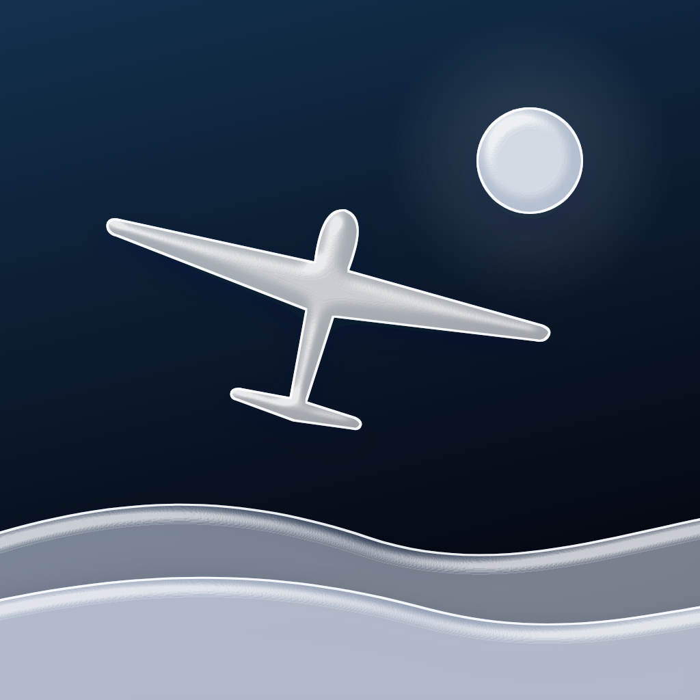
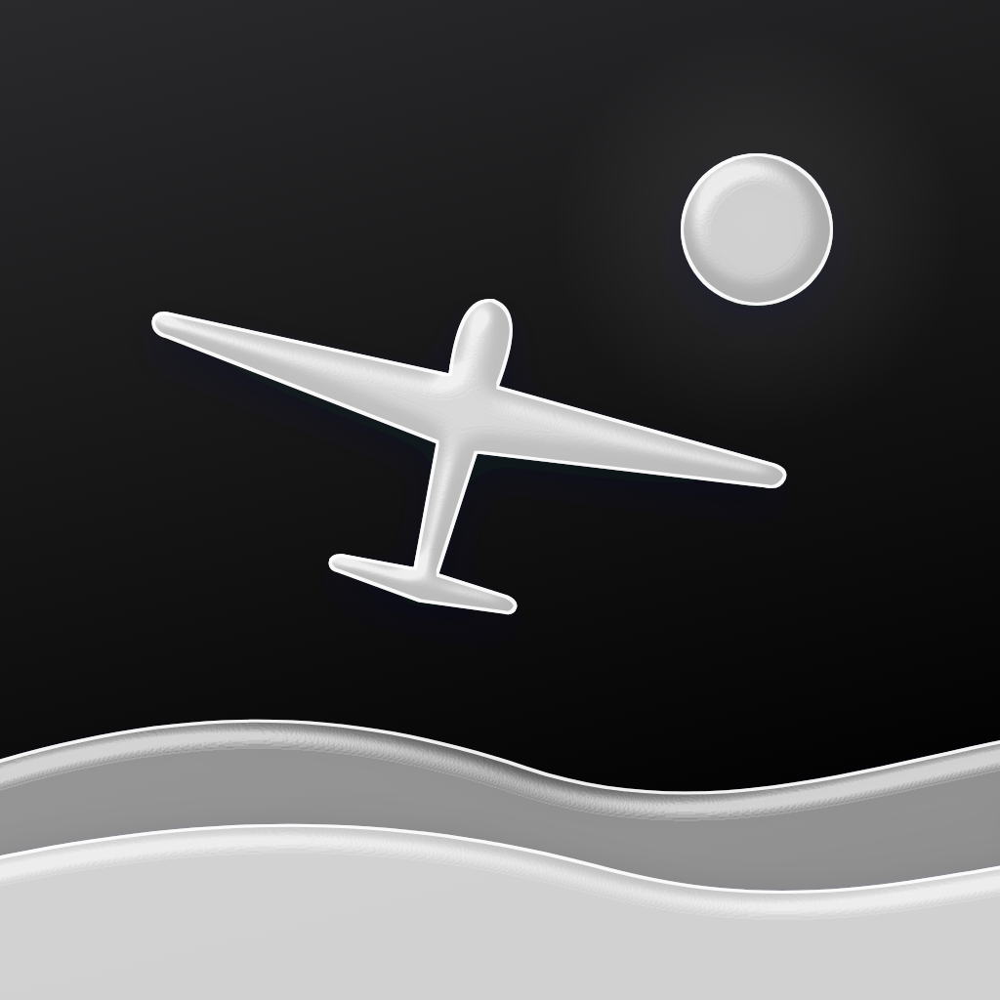

# App-icoon

Het icoon van **Winter**: een glazen zweefvliegtuig boven glazen sneeuwheuvels, met een winterzon in een heldere lucht. De winter is het onderhoudsseizoen van een zweefvliegclub, en dat is waar de app voor dient.

| Standaard | Donker | Getint |
|---|---|---|
|  |  |  |

## Opbouw
iOS 26 tekent app-iconen met **Liquid Glass**. Daarvoor bestaat het icoon uit losse lagen op een achtergrond; Icon Composer (bij Xcode 26) geeft elke laag glas, glans en diepte, en maakt automatisch de varianten Default, Dark, Clear en Tinted.

| Laag (achter → voor) | Bestand | Aanbevolen dekking |
|---|---|---|
| Achtergrond | verloop in Icon Composer | — |
| 1 · Zon | `layer-1-sun.svg` | 60% |
| 2 · Heuvel achter | `layer-2-hill-back.svg` | 24%, licht ijsblauw getint |
| 3 · Heuvel voor | `layer-3-hill-front.svg` | 34% |
| 4 · Zweefvliegtuig | `layer-4-glider.svg` | 70% |

Alle lagen zijn wit op een transparante achtergrond, 1024×1024, zonder afgeronde hoeken (iOS knipt zelf bij).

### Kleuren
Icon Composer kent een verloop met twee kleuren:

| | Boven | Onder |
|---|---|---|
| Lucht, standaard | `#4FD0FF` | `#3346C8` |
| Lucht, donker | `#12304D` | `#04060F` |

Zet de bovenste kleur zelf in plaats van op **Auto**; anders leidt Icon Composer ze af van de onderste.

## In Xcode met Icon Composer (aanbevolen)
1. Open **Icon Composer** en maak een nieuw icoon.
2. **Fill (achtergrond):** kies *Gradient* en vul de twee standaardkleuren hierboven in. Kies bovenaan het paneel de appearance *Dark* en vul daar de donkere kleuren in.
3. Maak vier groepen en sleep in elke groep één laag, in de volgorde van de tabel (zon achteraan, toestel vooraan).
4. Zet **Liquid Glass** aan op elke groep en stel de dekking in volgens de tabel. Geef de achterste heuvel een lichtblauwe tint (`#DDF1FF`).
5. Controleer Default, Dark, Clear en Tinted in de preview. De `icon-*-preview.svg`-bestanden tonen ongeveer hoe het eruit moet zien.
6. Bewaar als `AppIcon.icon` in de app-map en voeg het toe aan het target. Zet in de build settings `ASSETCATALOG_COMPILER_APPICON_NAME` op `AppIcon`.

## Zonder Icon Composer
Gebruik `icon-light-1024.png`, `icon-dark-1024.png` en `icon-tinted-1024.png` als de appearances Any, Dark en Tinted van een `AppIcon` in de asset catalog. Het glas is dan "ingebakken" en beweegt niet mee met het licht.

## Bestanden
| Bestand | Wat |
|---|---|
| `layer-*.svg` | De vier lagen voor Icon Composer |
| `icon-light/dark/tinted-preview.svg` | Benadering van het eindresultaat met SVG-filters |
| `icon-light/dark/tinted-1024.png` | Gerenderde previews; ook bruikbaar als vlakke fallback |

## Aanpassen
Alles wordt gemaakt door [`../generate.py`](../generate.py) (Python 3, alleen de standaardbibliotheek). Pas daar vorm of kleuren aan en draai `python3 generate.py` vanuit `Design/`. De PNG's maak je daarna opnieuw met een SVG-renderer naar keuze (bv. een browser, `rsvg-convert` of Inkscape).
