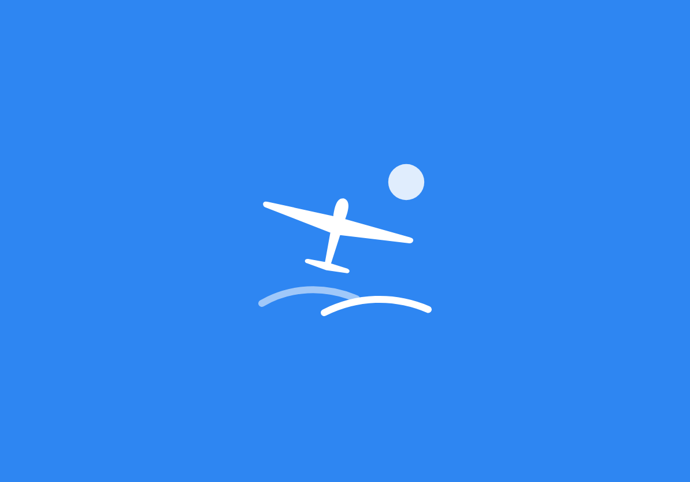
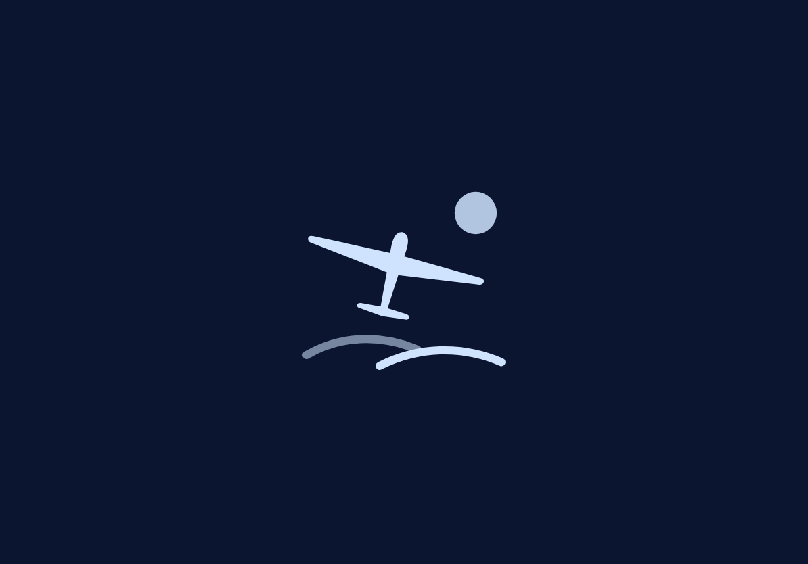

# Launch screen

Een vlakke versie van het app-icoon: dezelfde winterlucht als effen kleur, met in het midden de zon, het zweefvliegtuig en twee heuvelbogen, zonder glas en zonder tekst. Zo voelt de start aan als het openen van het icoon.

| Licht | Donker |
|---|---|
|  |  |

## Bestanden
| Bestand | Wat |
|---|---|
| `launch-mark.svg` | Merkteken voor licht: wit, 320×280 pt |
| `launch-mark-dark.svg` | Merkteken voor donker: ijsblauw `#CFE3FF` |

## Kleuren
| Appearance | Achtergrond | Merkteken |
|---|---|---|
| Licht | `#2E86F2` (middenkleur van de icoonlucht) | `#FFFFFF` |
| Donker | `#0B1530` (middenkleur van de donkere icoonlucht) | `#CFE3FF` |

## In Xcode zetten
1. Asset catalog → nieuwe **Image Set** `LaunchMark`:
   - Appearances: Any, Dark. Sleep `launch-mark.svg` in Any en `launch-mark-dark.svg` in Dark.
   - Scales: **Single Scale**, en vink **Preserve Vector Data** aan.
2. Asset catalog → nieuwe **Color Set** `LaunchBackground`: Any `#2E86F2`, Dark `#0B1530`.
3. Info.plist:
   ```xml
   <key>UILaunchScreen</key>
   <dict>
       <key>UIColorName</key>
       <string>LaunchBackground</string>
       <key>UIImageName</key>
       <string>LaunchMark</string>
       <key>UIImageRespectsSafeAreaInsets</key>
       <true/>
   </dict>
   ```
   Of in XcodeGen (`project.yml`):
   ```yaml
   info:
     properties:
       UILaunchScreen:
         UIColorName: LaunchBackground
         UIImageName: LaunchMark
         UIImageRespectsSafeAreaInsets: true
   ```
4. iOS toont het merkteken op zijn eigen grootte (320×280 pt), gecentreerd. Launch screens worden gecachet: verwijder de app en installeer ze opnieuw om een wijziging te zien.

## Overgang naar de app
Het startscherm van de app is licht grijs (`systemGroupedBackground`). Om de sprong van blauw naar grijs zacht te maken, kan het eerste scherm kort (±0,3 s) vanuit `LaunchBackground` naar de gewone achtergrond overvloeien, met het merkteken dat vervaagt. Dat is optioneel en gebeurt in SwiftUI, niet in het launch screen zelf.
